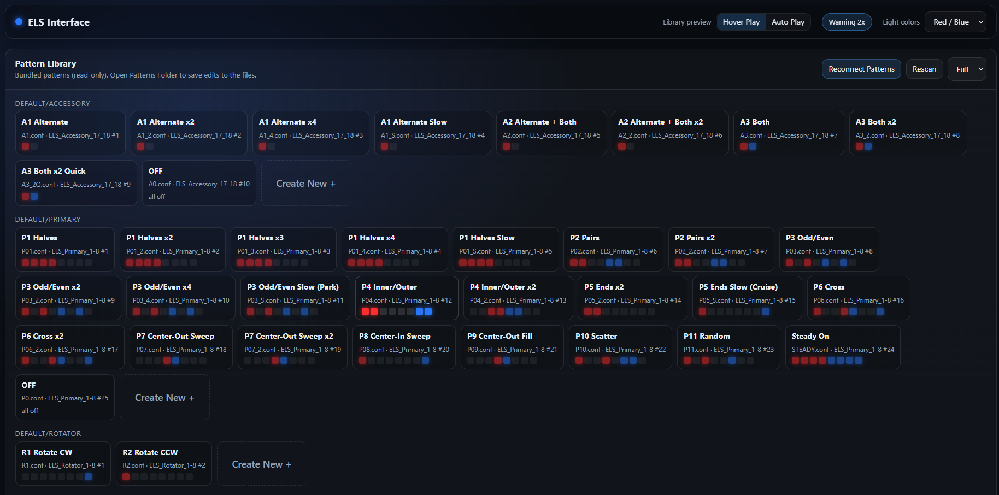
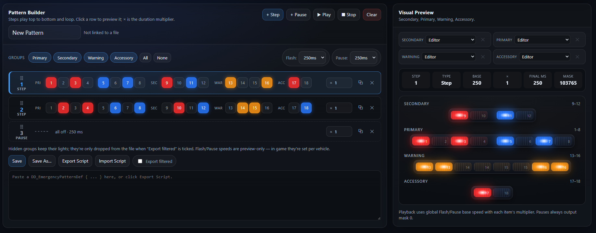

# Arma Reforger ELS

Emergency Lighting System for Arma Reforger by Delta District. Multiplayer-synced, multi-stage emergency lights with independent light groups, live pattern and speed control, and a browser-based pattern builder.

## Features

- **Four independent light groups**: Primary, Secondary, Warning and Accessory, each running its own pattern and timer.
- **Three stages**: Warning (1), Mixed (2) and Full (3). Which groups run at each stage is configurable per vehicle, and Stage 2 can use a subset of the primary lightbar.
- **67 built-in patterns**: halves, pairs, odd/even, inner/outer, cross, sweeps, chases, fills, rotators, slow park/cruise modes, random and cycle patterns.
- **Live speed control**: flash speed and pause length (Fast 100 ms / Medium 250 ms / Slow 500 ms), stored per stage.
- **Multiplayer**: the server owns stage, pattern and speed state and replicates it. Each client runs the flash timing locally, so bandwidth stays low regardless of flash rate.
- **Keyboard and gamepad bindings**, rebindable under *Settings → Keybinds → Emergency Lights*. Only active while driving an ELS vehicle.
- **Action menu support** with Stage, Flash Settings and Pattern Control submenus.
- **HUD hints and switch sounds**, with a toggle to hide the HUD.
- **Lights shut off** when the vehicle is destroyed.
- **Auto Lights component**: optionally turns lights on at spawn and off after a set time.
- **Bundled assets**: Red, Blue, Amber and White light prefabs (plus large Red/Blue), Single and Quad light fixtures, and preset light-slot configs.

## Player Controls

Controls work from the driver's seat. Patterns and speeds can only be changed while the lights are on.

| Action | Keyboard | Gamepad |
|---|---|---|
| Stage up (Off → 1 → 2 → 3 → Off) | `E` | `RB` + `D-pad Up` |
| Stage down | Hold `E` | `RB` + `D-pad Down` |
| Toggle lights | *unbound* | `RB` + `L-stick click` |
| Next Primary / Secondary / Warning / Accessory pattern | `Numpad 1` / `2` / `3` / `4` | `RB` + `A` / `X` / `Y` / `B` |
| Previous pattern | `Left Shift` + `Numpad 1–4` | — |
| Flash speed faster / slower | `Right Ctrl` + `Up` / `Down` | `RB` + `D-pad Right` / `Left` |
| Pause shorter / longer | `Right Ctrl` + `Right` / `Left` | — |
| Toggle ELS HUD | `End` | Double-tap `RB` |

## Vehicle Setup

1. **Controller**: add `ELS_EmergencyLightController` to the vehicle root. The root needs an `RplComponent` and the vehicle's light manager component.
2. **Lights**: add `ELS_LightSlot` entries to the light slots and give each one an **ELS ID**. Default layout:

   | IDs | Group |
   |---|---|
   | 1–8 | Primary |
   | 9–12 | Secondary |
   | 13–16 | Warning |
   | 17–18 | Accessory |

   IDs up to 24 are supported. Use the `VehicleLight_ELS_*` prefabs and the configs in `Configs/Vehicle/ELS/LightSlots`, and the `ELS_LightFixture_*` prefabs for visible housings.
3. **Groups and patterns**: on the controller, set each group's ID list and pattern set (`ELS_Primary_1-8`, `ELS_Rotator_1-8`, `ELS_Secondary_9-12`, `ELS_Warning_13-16`, `ELS_Accessory_17_18`). Extra patterns can be added per vehicle.
4. **Stages**: choose which groups run at each stage, and set `Stage2PrimaryIDs` for the Stage 2 lightbar subset.
5. **Optional**: add `DD_AutoEmergencyLightsComponent` for vehicles that should spawn with lights on.

## Custom Patterns

A pattern is a list of steps. Each step has a `Mask`, a bitmask of ELS IDs that are lit (bit 0 = ID 1 … bit 23 = ID 24), and a `Duration` multiplier (higher = longer). Pauses are steps with every light off.

Patterns are `DD_EmergencyPatternDef` configs, grouped into `DD_EmergencyPatternSet` configs under `Configs/Vehicle/ELS/Patterns`. The ELS Pattern Builder below creates, previews and saves them directly.

## Pattern Builder

`ELS_PatternUI.html` is a standalone editor that runs in your browser. Nothing needs to be installed.



- **Pattern library**: open your addon's `Patterns` folder to load every pattern set. Patterns are listed by group. Drag them to reorder, which also updates the set file. Use **Create New** to start a new pattern. Click the library header to collapse it, and use the dropdown to switch between half and full height.
- **Step editor**: add steps and pauses with **+ Step** and **+ Pause**. Click IDs to turn them on or off. Set each step's duration multiplier, and drag steps to reorder them.
- **Live preview**: press **Play** to see the pattern at the chosen flash and pause speed. Hover Play and Auto Play preview library patterns without opening them.
- **Combined preview**: load a library pattern into each group's slot (Primary, Secondary, Warning, Accessory) to see them running together on independent timers, as they would on a vehicle.

  
- **Warning 2x**: shows two lights per warning ID, for vehicles with doubled warning lights. This only changes the preview.
- **Save / Import / Export**: patterns are written as Reforger `.conf` files, ready for Workbench.

## Repository Layout

```
Configs/
  System/            Input context and keybind menu
  ControlHints/      HUD control hints
  Vehicle/ELS/
    LightSlots/      Preset ELS light slots
    Patterns/        Pattern definitions and sets
Prefabs/Vehicles/Core/
  ELS_Lights/        Light prefabs
  ELS_Parts/         Light fixtures
scripts/Game/ELS/    Controller, light slot, configs, actions, auto lights
```
